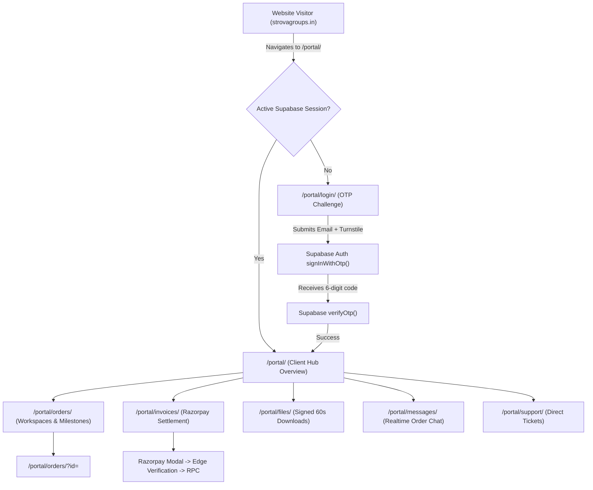

# Strova Group Client Hub — User Flows & Operational Runbook

**Document Version:** 1.0.0  
**Audit Date:** 2026-10-16  
**Auditor:** Senior Full-Stack & Product Architecture Engineering  
**Portal URL:** `https://strovagroups.in/portal/`  
**Authentication Standard:** Passwordless Email One-Time Passcode (OTP) via Supabase Auth

---

## 1. Client Journey Architecture

---

## 2. Authentication & Session Lifecycles

### 2.1 Passwordless Login Flow (`/portal/login/`)
1. **Entry Point:** Client visits `https://strovagroups.in/portal/login/`.
2. **Session Pre-Check:** Client-side JavaScript verifies if a valid JWT exists in browser storage via `supabase.auth.getSession()`. If active, automatically redirects to `/portal/` (or `/portal/admin/` for staff).
3. **Turnstile Bot Deterrence:** An interactive Cloudflare Turnstile widget verifies the visitor is not an automated bot. The submit button is disabled until a valid token is issued.
4. **Email Submission:** Client submits their registered email address. `signInWithOtp` is invoked with `shouldCreateUser: false` (strictly invite-only).
5. **Passcode Input:** If the email exists, the view transitions to a 6-digit numeric input with a 5-minute expiry timer.
6. **Verification & Redirection:** Entering the 6-digit code triggers `supabase.auth.verifyOtp({ email, token, type: 'email' })`. Upon success, the profile role is checked and the user is redirected to `/portal/` (or the validated internal `redirect` query parameter).

### 2.2 Secure Session Teardown (`/portal/logout/`)
1. Visiting `/portal/logout/` invokes `supabase.auth.signOut()`.
2. Active real-time subscription channels are terminated.
3. JWT tokens are removed from browser storage.
4. User is redirected to `/portal/login/`.

---

## 3. Project Milestone & Delivery Tracking (`/portal/orders/`)

### 3.1 Overview List
- Retrieves orders where `orders.client_id = auth.uid()` via PostgREST.
- Displays project title, division badge (`technologies`, `digital`, `commerce`), agreed completion date, budget, and live status badge.

### 3.2 Workspace Detail View (`/portal/orders/?id=<id>`)
- **Authorization Guard:** The query strictly filters by `id=eq.<id>` and `client_id=eq.<auth.uid()>`. If 0 rows return, the view displays the "Access Denied / Not Found" security card.
- **Milestone Timeline:** Chronological list of events (`order_events`) showing stage transitions:
  1. *Brief received* (10%)
  2. *Scope agreed* (25%)
  3. *Advance received* (40%)
  4. *In progress* (65%)
  5. *Review* (85%)
  6. *Delivered & Settled* (100%)
- **Private Deliverables:** List of deliverable files. Clicking "Download" generates an HMAC-SHA256 signed URL with a 60-second expiration.
- **Direct Order Messages:** Live messaging panel scoped to the project with Supabase Realtime updates.

---

## 4. Invoices & Atomic Payment Settlement (`/portal/invoices/`)

### 4.1 Invoice Lifecycle
- Invoices are generated exclusively by Strova Operations administrators (`status: 'Pending'`).
- Invoices list order reference, invoice number, amount in INR/paise, and due date.

### 4.2 Checkout & Settlement Execution
1. Client clicks "Pay via Razorpay".
2. Frontend calls Supabase Edge Function `create-razorpay-order` with the `invoice_id`.
3. The Edge Function runs `assign_invoice_razorpay_order` in PostgreSQL using Compare-And-Swap (CAS) to atomically assign or retrieve an active Razorpay Order ID.
4. Razorpay Checkout modal opens with the Order ID.
5. Client completes payment via UPI, NetBanking, or Card.
6. Razorpay returns `razorpay_payment_id`, `razorpay_order_id`, and `razorpay_signature`.
7. Client posts these credentials to `verify-razorpay-payment`.
8. The function verifies the HMAC signature, executes `finalize_payment` in PostgreSQL, updates the invoice to `Paid`, recalculates order balance, and logs an audit record.
9. UI re-fetches and displays the green "Paid" badge and updated balance.

---

## 5. Support Ticket Desk (`/portal/support/`)

1. **Ticket Submission:** Clients can submit tickets with Priority (`Normal`, `Urgent`, `Critical`) and optional association with an active `order_id`.
2. **Database Verification:** RLS policy validates that the client owns the referenced `order_id`.
3. **Real-time Responses:** Live responses from Strova staff are subscribed via `supabase_realtime` on `public.support_responses`.

---

## 6. Operations Administration Console (`/portal/admin/`)

1. **Access Control:** Rendered only when `profile.role === 'admin'`. RLS policies reject non-admin queries.
2. **Operations Capabilities:**
   - View cross-tenant project list and metrics.
   - Inject verified milestone updates (`order_events`).
   - Issue commercial invoices (`invoices`) tied to agreed project milestones.
   - Reply to client support requests.
   - Inspect immutable security audit logs (`public.audit_log`).

