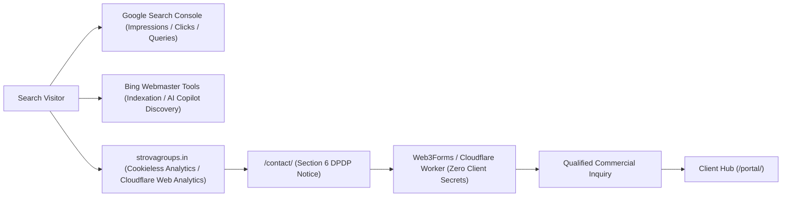

# Strova Group — Technical SEO & Growth Measurement Plan

**Document Version:** 1.0.0  
**Audit Date:** 2026-10-16  
**Auditor:** Technical SEO & Performance Specialist  
**Primary Domain:** `https://strovagroups.in`  
**Measurement Philosophy:** Privacy-Preserving, Zero-Third-Party Trackers, Conversion-Focused

---

## 1. Measurement Architecture & Tooling

Strova Group utilizes privacy-friendly analytics and authoritative search console signals to measure commercial visibility without compromising visitor privacy or setting invasive tracking cookies.

---

## 2. Platform Setup & Webmaster Tool Configuration

### 2.1 Google Search Console (GSC)
1. **Property Type:** Add Domain property `strovagroups.in` via DNS TXT record verification on Cloudflare DNS.
2. **Sitemap Submission:** Submit `https://strovagroups.in/sitemap-index.xml`.
3. **Indexation Audit:** Verify that all 32 public pages are indexed while confirm that `/portal/*` URLs are rejected by `robots.txt` Disallow rules.
4. **Hreflang Validation:** Confirm that Google recognizes bidirectional English (`x-default` / `en`) and Hindi (`hi`) alternate relationships.

### 2.2 Bing Webmaster Tools
1. Import verified domain from Google Search Console.
2. Submit `https://strovagroups.in/sitemap-index.xml`.
3. Enable Bing IndexNow for instantaneous notification of new case studies or articles.

### 2.3 Cloudflare Web Analytics (Cookieless)
- Enabled at the DNS/CDN level via Cloudflare Dashboard.
- Captures aggregated pageviews, visits, Core Web Vitals (LCP, FID/INP, CLS), and country distribution without placing client cookies or logging IP addresses.

---

## 3. Weekly & Monthly Monitoring Cadence

### 3.1 Weekly Review (30 Minutes)
- **Search Impressions & Clicks (GSC):**
  - Track query performance for target terms: "custom web application development india", "astro js developer", "website redesign for business", "whatsapp cloud api integration".
  - Monitor CTR anomalies on high-impression queries (identify opportunities to improve title tags or meta descriptions).
- **Indexation Coverage:**
  - Verify 0 "Indexed though blocked by robots.txt" warnings for `/portal/`.
  - Confirm 0 unexpected 5xx or 404 crawl errors in GSC.
- **Form Conversion Submissions:**
  - Audit count of genuine inbound inquiries submitted via `/contact/`.
  - Verify honeypot filter efficacy (spam blocked vs. valid business inquiries received).

### 3.2 Monthly Review (60 Minutes)
- **Core Web Vitals Assessment (CrUX / PageSpeed Insights):**
  - Verify LCP remains under 2.5s (target < 1.8s).
  - Verify CLS remains at 0.00.
  - Verify INP remains under 200ms (target < 50ms).
- **AI Search Discoverability:**
  - Query ChatGPT Search, Perplexity AI, and Google AI Overviews for "Strova Group" and "Strova Group custom web applications" to ensure accurate business citations and link references.
  - Update `public/llms.txt` with newly delivered case studies.
- **Conversion Funnel Health:**
  - Inquiries received -> Qualified leads -> Formal proposals sent -> Onboarded portal clients.
  - Assess feedback from prospective clients regarding website clarity and pricing transparency.

---

## 4. Event & Conversion Tracking Matrix

All conversion signals are measured on the server or via aggregated privacy-safe counters:

| Milestone / Event | Measurement Point | Privacy Protection Standard |
| :--- | :--- | :--- |
| **Page Visit** | CDN / Cloudflare Web Analytics | Cookieless, aggregated, zero personal data |
| **Contact Form Inbound** | Cloudflare Pages Function `/api/privacy-request` or Web3Forms | No analytics event containing email or message text |
| **Quote Inbound** | Redirect to `/quote/confirmed/` | Distinct URL allows goal tracking in Webmaster Tools |
| **Portal Login** | Supabase Auth Audit Log (`public.audit_log`) | Stored in private database; excluded from web analytics |
| **Milestone Payment** | Razorpay Dashboard & Supabase `public.payments` | Financial record; zero marketing analytics tracking |

